## Polyhedron Generator
|||
| --- | --- |
|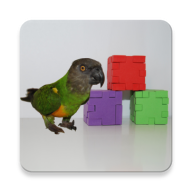|Android (Studio) app: Creating polyhedrons (in a skew coordinate system) by specifying points & edges. Educational for 4th year of "Junior High" / subject: "geometric drawing". Bilingual app: english & german.|

## Screens
|||
| --- | --- |
|<figure>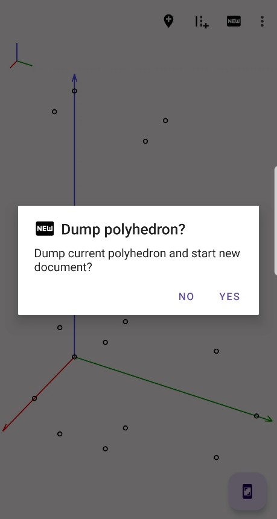 <figuretext>(1) Start new document by clicking on symbol&nbsp;&nbsp;</figuretext></figure>| <figure>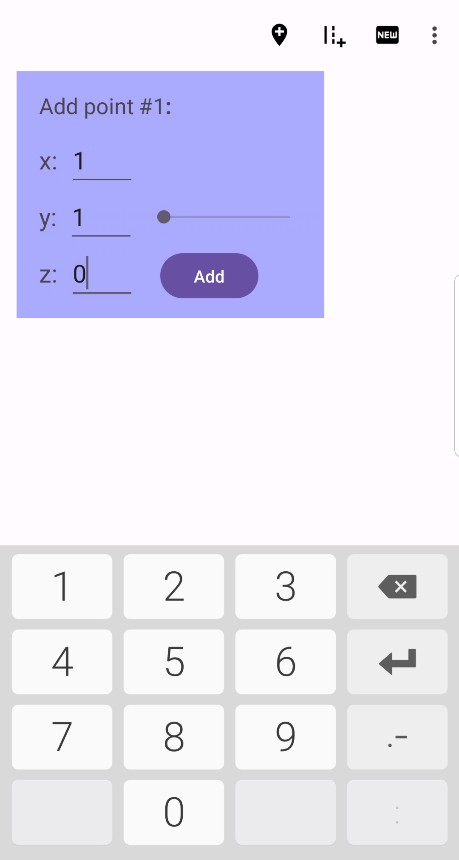 <figuretext>(2) Add a point by clicking on symbol&nbsp;&nbsp;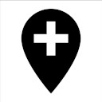</figuretext></figure>|
| <figure>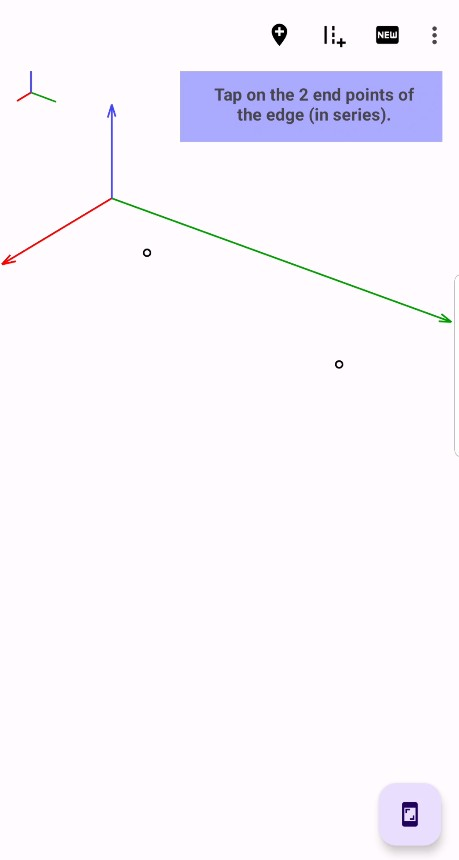 <figuretext>(3) Add edge (having at least 2 points on canvas) by clicking on symbol&nbsp;&nbsp;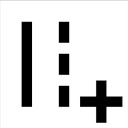</figuretext></figure>|<figure>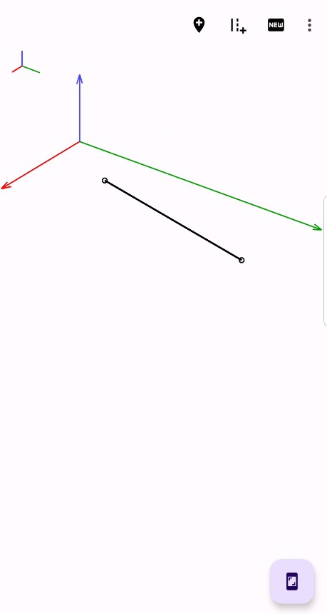 <figuretext>(4) Finished edge.</figuretext></figure>|
|<figure>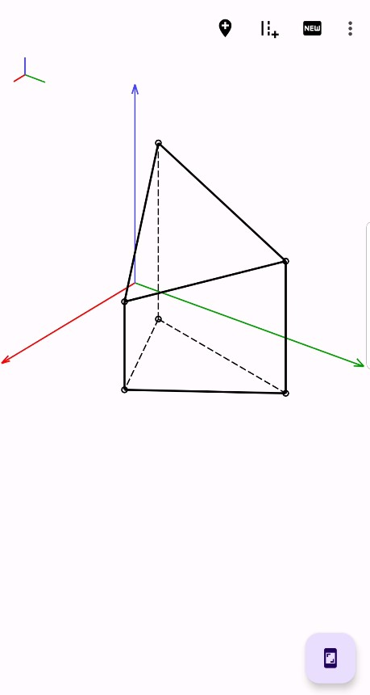 <figuretext>(5) Completed polyhedron (axes lenghts got auto-adapted).</figuretext></figure>|<figure>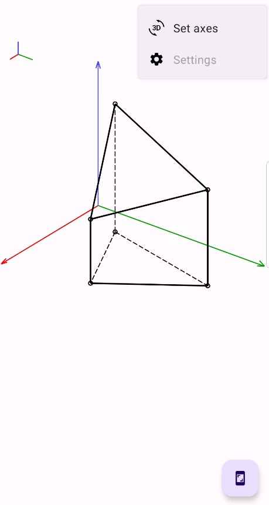 <figuretext>(6) Open menu by clicking on symbol&nbsp;&nbsp;</figuretext></figure>|
|<figure>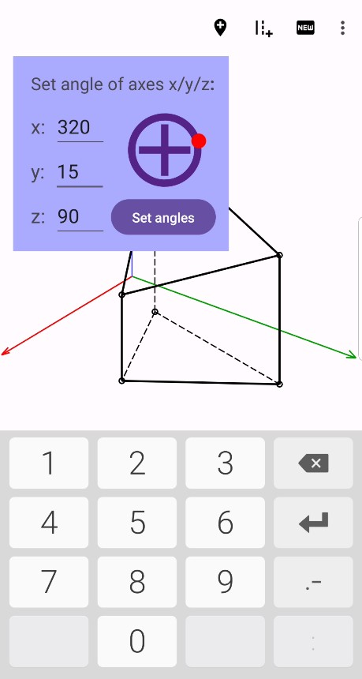 <figuretext>(7) Set axes by clicking on symbol&nbsp;&nbsp;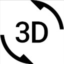</figuretext></figure>| <figure>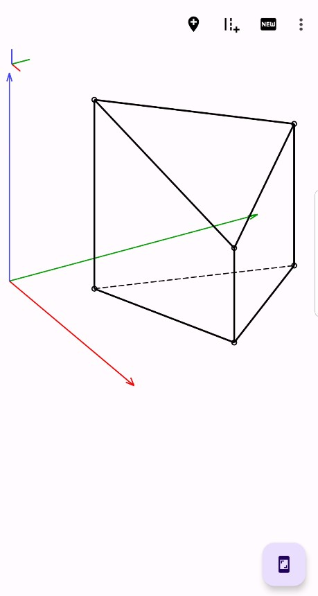 <figuretext>(8) Polyhedron (seen with other axes angles).</figuretext></figure>|
 
